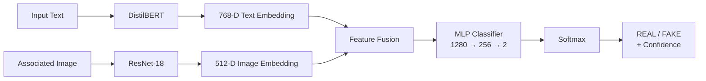

# Multimodal Misinformation Detector

A multimodal deep learning system that analyzes a text claim together with its associated image to classify the sample as **Real** or **Fake**.

The system combines pretrained **DistilBERT** for textual representation and **ResNet-18** for visual representation, followed by feature fusion and a lightweight neural classification head.

## Problem Statement

Misinformation can be communicated through multiple modalities. This project therefore analyzes both textual and visual information rather than relying on a single input modality.

**Input:** News/social-media text + associated image  
**Output:** Real/Fake prediction + confidence score

## Approach

The system uses a two-branch transfer-learning architecture:

1. Text is tokenized and passed through pretrained DistilBERT.
2. The associated image is preprocessed and passed through pretrained ResNet-18.
3. The resulting text and image embeddings are concatenated.
4. A fully connected neural network performs binary classification.
5. Softmax probabilities are used to generate the predicted class and confidence.

The pretrained encoders are frozen for the reported training run, while the fusion classifier is trained on top of their representations.

## Architecture



## Data Flow

```text
Text
  ↓
Tokenizer
  ↓
DistilBERT
  ↓
768-D Text Embedding
       \
        \
         → Concatenation → MLP → Softmax → Real / Fake
        /
       /
Image
  ↓
Resize + Normalize
  ↓
ResNet-18
  ↓
512-D Image Embedding
```

## Dataset

The project uses the **Fakeddit** multimodal misinformation dataset and a manageable subset suitable for the one-day implementation.

| Split | Samples |
|---|---:|
| Train | 12,000 |
| Validation | 1,500 |
| Test | 1,500 |

### Labels

| Class ID | Label |
|---:|---|
| 0 | Real |
| 1 | Fake |

The data pipeline separates raw source data from processed data and validates downloaded images before constructing the final multimodal splits.

## Preprocessing

### Text

- Hugging Face pretrained tokenizer
- DistilBERT tokenization
- Maximum sequence length: 128
- Truncation enabled
- Dynamic padding
- Token type IDs disabled

### Image

- PIL image loading
- RGB conversion
- ResNet-18 pretrained transformation pipeline
- 224 × 224 input

## Model

### Text Encoder

**DistilBERT — `distilbert-base-uncased`**

- 768-dimensional text representation
- Pretrained
- Frozen during Stage 1 training

### Image Encoder

**ResNet-18**

- Original classification head removed
- 512-dimensional visual representation
- Pretrained
- Frozen during Stage 1 training

### Fusion Classifier

```text
768-D text embedding
        +
512-D image embedding
        ↓
1280-D fused representation
        ↓
Linear(1280 → 256)
        ↓
ReLU
        ↓
Dropout(0.30)
        ↓
Linear(256 → 2)
        ↓
Real / Fake
```

## Training

| Parameter | Value |
|---|---|
| Optimizer | AdamW |
| Loss | Cross Entropy |
| Batch Size | 16 |
| Epochs | 3 |
| Learning Rate | 1e-4 |
| Weight Decay | 1e-4 |
| Gradient Clipping | 1.0 |
| Mixed Precision | Enabled on CUDA |
| Early Stopping Patience | 2 |
| Best Checkpoint | Minimum Validation Loss |

### Training History

| Epoch | Train Loss | Train Accuracy | Val Loss | Val Accuracy |
|---:|---:|---:|---:|---:|
| 1 | 0.4904 | 75.52% | 0.4360 | 76.47% |
| 2 | 0.4168 | 80.31% | 0.4137 | 79.87% |
| 3 | 0.3946 | 81.88% | 0.4023 | 81.33% |

The experiment configuration is centralized in `configs/base.yaml`, including dataset sizes, model names, training parameters, checkpoint settings, and evaluation settings. base

## Evaluation

Evaluation was performed on the held-out **1,500-sample test split**.

| Metric | Score |
|---|---:|
| Accuracy | **80.93%** |
| Precision | **74.44%** |
| Recall | **78.96%** |
| F1 Score | **76.63%** |
| ROC-AUC | **88.50%** |

### Confusion Matrix

| Actual / Predicted | Real | Fake |
|---|---:|---:|
| Real | 745 | 161 |
| Fake | 125 | 469 |

### Evaluation Artifacts

```text
results/
├── evaluation_metrics.json
├── classification_report.csv
├── test_predictions.csv
├── confusion_matrix.png
└── roc_curve.png
```

## Example Inference

The project provides a command-line inference interface:

```powershell
python -m scripts.predict --text "this reflection on a lake at night" --image "data\processed\images\test\d4nf8o.jpg"
```

Example functional smoke-test result:

```text
Prediction     : FAKE
Confidence     : 56.05%
Probability Real: 43.95%
Probability Fake: 56.05%
```

This example demonstrates inference pipeline functionality and is not intended as a benchmark of model quality.

## Streamlit Demo

The project includes a polished Streamlit interface for interactive multimodal inference.

Run:

```powershell
streamlit run app.py
```

The application provides:

- Text/claim input
- Image upload and preview
- Multimodal prediction
- Confidence score
- Real/Fake probability breakdown
- Technical model information
- Cached model loading for repeated inference

## Project Structure

```text
Multimodal Misinformation Detector/
├── app.py
├── configs/
│   └── base.yaml
├── data/
│   └── processed/
├── models/
│   └── checkpoints/
├── notebooks/
│   ├── 01_dataset_exploration.ipynb
│   ├── 02_text_pipeline.ipynb
│   ├── 03_image_pipeline.ipynb
│   ├── 04_multimodal_fusion.ipynb
│   ├── 05_training.ipynb
│   ├── 06_evaluation.ipynb
│   └── 07_inference.ipynb
├── results/
├── scripts/
├── src/
│   ├── datasets/
│   ├── evaluation/
│   ├── inference/
│   ├── models/
│   ├── preprocessing/
│   ├── training/
│   └── utils/
├── .gitignore
├── README.md
├── requirements.txt
├── requirements-dev.txt
└── requirements-lock.txt
```

## How to Run

### 1. Create the environment

```powershell
python -m venv .venv
.venv\Scripts\activate
```

### 2. Install dependencies

```powershell
pip install -r requirements.txt
```

### 3. Verify the environment

```powershell
python -m scripts.verify_environment
```

### 4. Place the trained checkpoint

```text
models/checkpoints/best_model.pt
```

Large model artifacts should generally remain outside normal Git history unless managed through an appropriate artifact/versioning system.

### 5. Run CLI inference

```powershell
python -m scripts.predict --text "Example news headline" --image "path\to\image.jpg"
```

### 6. Run the Streamlit application

```powershell
streamlit run app.py
```

On first use, pretrained DistilBERT and ResNet weights may be downloaded automatically.

## Reproducibility

Project configuration is centralized in:

```text
configs/base.yaml
```

This configuration controls:

- Random seed
- Dataset sizes
- Model names
- Text sequence length
- Training hyperparameters
- Checkpoint selection
- Evaluation metrics
- Image download settings

The project therefore avoids scattering experiment parameters throughout the codebase.

## Limitations

- The reported model is trained on a subset rather than the complete Fakeddit corpus.
- The pretrained encoders are frozen in the reported training run.
- Confidence represents the model's predicted class probability and is not a guarantee of factual truth.
- Performance may vary on domains, topics, image styles, and misinformation patterns not represented in the training data.

## Technologies

**Python · PyTorch · Hugging Face Transformers · DistilBERT · Torchvision · ResNet-18 · Pillow · Pandas · NumPy · Scikit-learn · Matplotlib · Seaborn · Streamlit · YAML**

## Skills Demonstrated

**Multimodal Learning · Transfer Learning · NLP · Computer Vision · Transformers · CNNs · Neural Networks · PyTorch Training & Inference · Model Evaluation · Interactive Model Deployment**